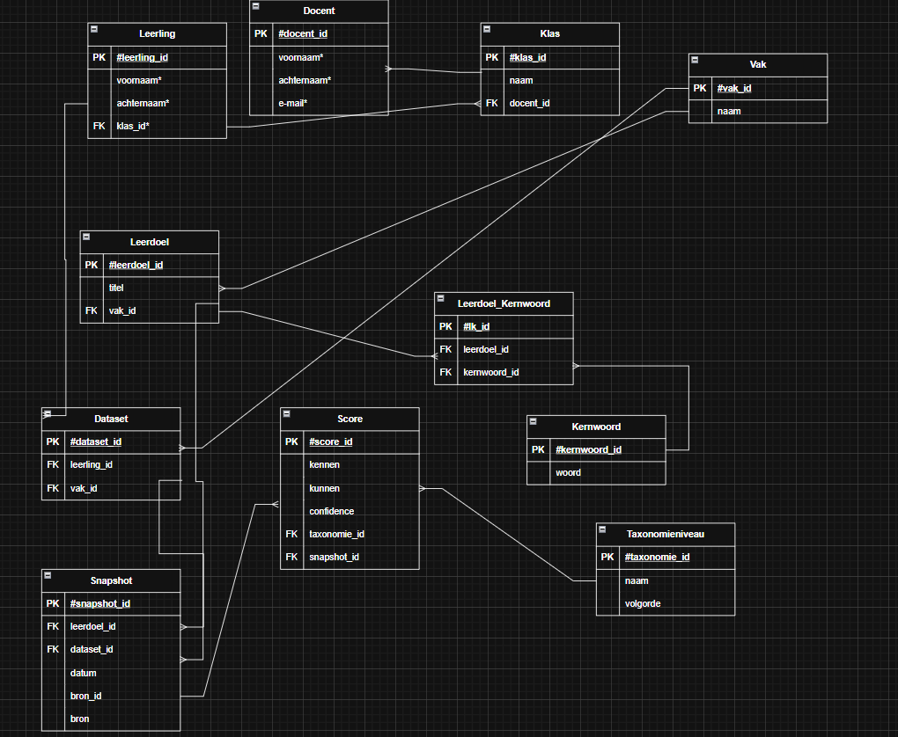
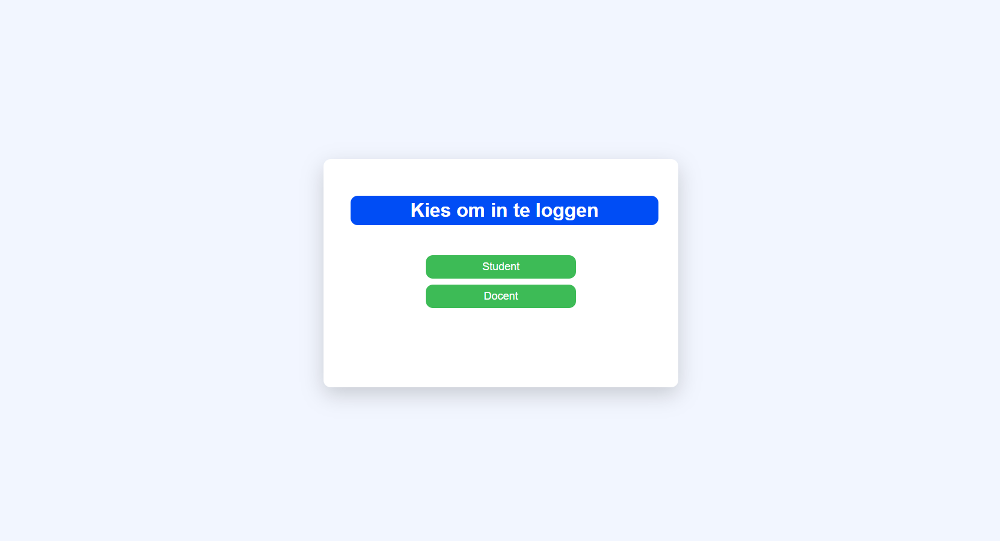
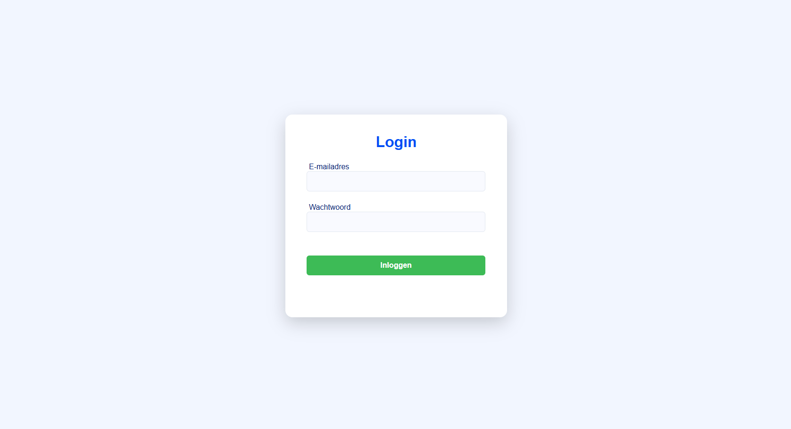
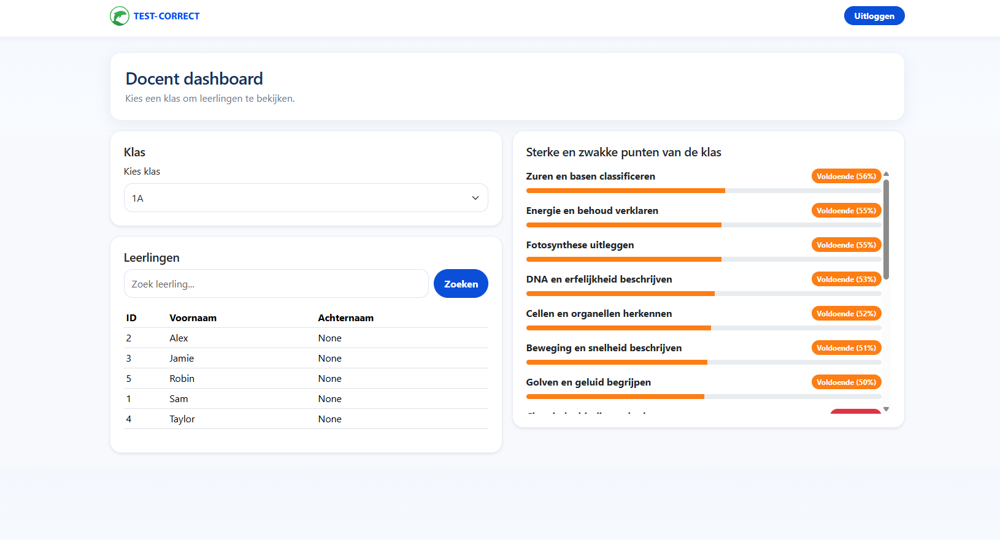
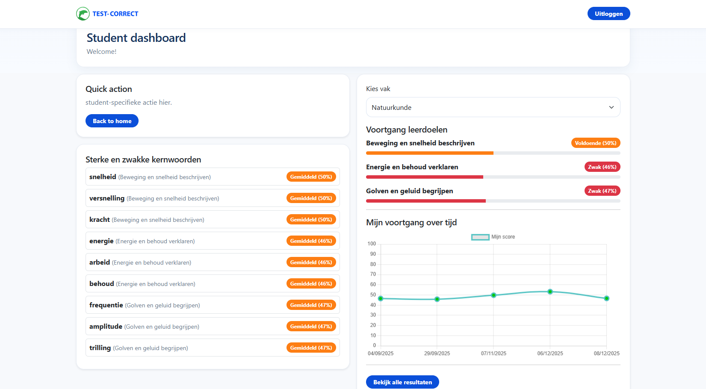
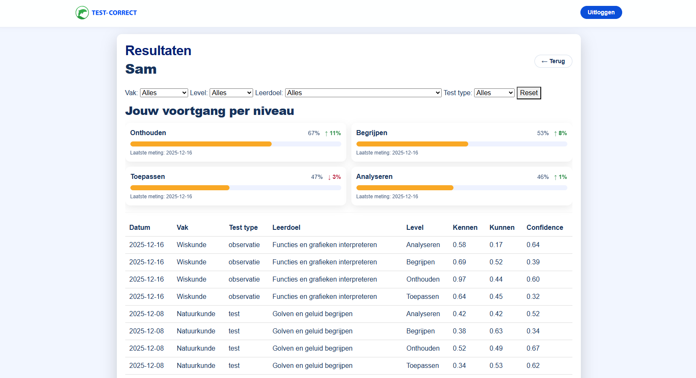

# Installatie + Setup
Volg de onderstaande stappen om de applicatie lokaal te runnen.
1. **Clone de repository:**\
``git clone https://github.com/Rac-Software-Development/wp3-2026-rest-1b6-fox.git``
2.  **Maak een Virtual Environment:**\
``python -m venv .venv``
3. **Activate Virtual Environment:**
- Windows:
``.venv\Scripts\activate``
- macOS/Linux:
``. .venv/bin/activate``
4. **Installeer de requirements.txt:**\
``pip install -r requirements.txt``
5. **Start de applicatie:**\
``python app.py``

# Inloggegevens
### Docent - Dummyaccount
- Email: ``docent@test.nl``
- Password: ``docent123``

### Student - Dummyaccount
- Email: ``student@test.nl``
- Password: ``student123``

# ERD

# Screenshots

### Startscherm:

### Inlogscherm:

### Dashboard docent:

### Dashboard student:

### Resultaten:

# **APA bronnen**

Ilias bronnen:
- Programming with Mosh. (2018, April 24). JavaScript Course for Beginners – Your First Step to Web Development [Video]. YouTube. https://www.youtube.com/watch?v=W6NZfCO5SIk
- Programming with Mosh. (2018a, March 30). Object-oriented programming in JavaScript: Made super simple | Mosh [Video]. YouTube. https://www.youtube.com/watch?v=PFmuCDHHpwk
- Lucid Software. (2017, March 6). Entity Relationship Diagram (ERD) Tutorial - Part 1 [Video]. YouTube. https://www.youtube.com/watch?v=QpdhBUYk7Kk
- GeeksforGeeks. (2025, July 23). How to Link JavaScript File to a Separate HTML File? GeeksforGeeks. https://www.geeksforgeeks.org/html/how-to-link-javascript-file-to-a-separate-html-file/
- API — Flask Documentation (3.2.x). (n.d.). https://flask.palletsprojects.com/en/latest/api/#flask.json.jsonify
- W3Schools.com. (n.d.). https://www.w3schools.com/sql/sql_like.asp
- : The HTML Input element - HTML | MDN. (2026, February 13). https://developer.mozilla.org/en-US/docs/Web/HTML/Reference/Elements/input
- W3Schools.com. (n.d.-b). https://www.w3schools.com/html/html_forms.asp
- W3Schools.com. (n.d.-c). https://www.w3schools.com/html/html_form_input_types.asp
- Buvesa. (2020, June 8). HTML TUTORIAL VOOR BEGINNERS | 👉 Gratis HTML cursus om websites te maken (Nederlands) [Video]. YouTube. https://www.youtube.com/watch?v=gMBUxCgcz1g
- LinkedIn Learning. (2013, January 31). JavaScript Tutorial - What is AJAX? [Video]. YouTube. https://www.youtube.com/watch?v=RDo3hBL1rfA
- LearnWebCode. (2016, October 27). JSON and AJAX tutorial: with real examples [Video]. YouTube. https://www.youtube.com/watch?v=rJesac0_Ftw
- Learning Software. (2025, February 4). Secure and simple role based authorization in python Flask apps with Keycloak [Video]. YouTube. https://www.youtube.com/watch?v=AKTmvERQu20
- Dias, P. (2019, May 16). How do I implement a role Based Permission system on a webpage? Stack Overflow. https://stackoverflow.com/questions/56175371/how-do-i-implement-a-role-based-permission-system-on-a-webpage

Karina bronnen:

- Chart.js. (n.d.). Chart.js – Documentatie. https://www.chartjs.org/docs/latest/
- Bootstrap. (2023). Bootstrap 5.3 – Documentatie. https://getbootstrap.com/docs/5.3/
- Mozilla Developer Network. (n.d.). Fetch API – MDN Web Docs. https://developer.mozilla.org/en-US/docs/Web/API/Fetch_API
- Mozilla Developer Network. (n.d.). MDN Web Docs (algemeen). https://developer.mozilla.org/
- Nagix. (n.d.). Chart.js Realtime plugin (voor live/scrollende grafieken). https://nagix.github.io/chartjs-plugin-streaming/
- Flask Documentation. (n.d.). Flask – Documentatie. https://flask.palletsprojects.com/
- SQLite. (n.d.). SQLite – Officiële documentatie. https://www.sqlite.org/docs.html
- SQLite. (n.d.). SQLite SQL syntax (SELECT, queries). https://www.sqlite.org/lang.html
- Python Software Foundation. (2024). Python sqlite3 module – DB-API 2.0 interface voor SQLite. https://docs.python.org/3/library/sqlite3.html
- W3Schools.com. (n.d.). W3Schools SQL Tutorial. https://www.w3schools.com/sql/
- JSON.org. (n.d.). JSON – Introductie en structuur. https://www.json.org/json-en.html
- Chart.js. (n.d.). Chart.js Samples (dynamische grafieken). https://www.chartjs.org/docs/latest/samples/
- Mozilla Developer Network. (n.d.). Async JavaScript / Promises / async-await. https://developer.mozilla.org/en-US/docs/Learn/JavaScript/Asynchronous/Promises
- Mozilla Developer Network. (n.d.). Foutafhandeling bij fetch (try/catch voorbeeld). https://developer.mozilla.org/en-US/docs/Web/API/Fetch_API/Using_Fetch#handling_errors
